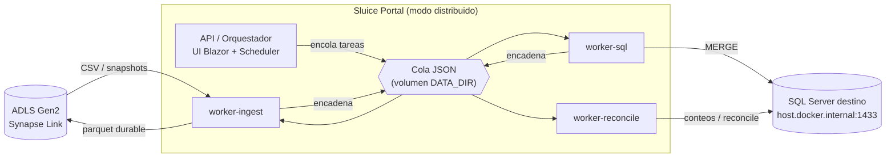

# Sluice Portal

[](LICENSE)
[](https://ko-fi.com/staroffire28)

Portal de control y observabilidad para un pipeline de integración de datos: **ADLS Gen2 (Synapse Link) → Parquet → SQL Server MERGE**.

## Documentation

The full user guide (English) lives in [`docs/guia-usuario/`](docs/guia-usuario/README.md) and is also served inside the portal under **Help** (`/ayuda`):

- [Introduction](docs/guia-usuario/01-introduction.md), [Functionality](docs/guia-usuario/02-functionality.md), [Installation](docs/guia-usuario/03-installation.md), [Reference](docs/guia-usuario/04-reference.md).
- [Authentication (Diataxis)](docs/auth/README.md) — dual UI session + worker key: [tutorial](docs/auth/tutorial-first-login-docker.md), [how-to](docs/auth/howto-login-and-api-access.md), [reference](docs/auth/reference-dual-auth.md), [explanation](docs/auth/explanation-dual-auth.md).

> Note: the sections below about operational environment variables and credential fallback reflect a historical state. The current behavior is documented in the user guide ([Installation](docs/guia-usuario/03-installation.md), [Reference](docs/guia-usuario/04-reference.md)): operational parameters live in `/settings`, credentials are set per Connection, and the UI requires `UI_API_KEY` login.

## Funcionalidad

- **Conexiones** — CRUD de orígenes ADLS Gen2 y destinos SQL Server (páginas Sources/Destinations). Secretos cifrados at-rest y enmascarados. **Test de conexión** contra ADLS/SQL reales con indicador de progreso (FluentUI) y timeout corto para fallar rápido ante hosts inalcanzables.
- **Pipelines** — CRUD, ejecución manual (Incremental / Force / Reconcile / Diff) y **scheduler** automático que auto-lanza Incremental cuando hay snapshots pendientes.
- **Jobs** — histórico paginado, detalle con timeline y progreso por etapa, cancelar en ejecución y **reintentar** jobs terminados en error / parcial / bloqueado (crea una ejecución nueva, conserva el job fallido como historial).
- **Tablas** — row counts, watermarks y divergencia por entidad. **Pausar / reanudar la sincronización por tabla** (por defecto habilitada): una tabla pausada se omite en el ingest y no llega al MERGE; su estado se conserva.
- **Reconcile & Diff** — reportes por pipeline, re-sincronización por tabla (Reload / Remerge) y generación de PDF.
- **Traducción de enums** (`TRANSLATE_ENUMS`, opt-in) — añade al final de cada tabla una columna `[<col>_$label]` con el ExternalValue del optionset (idioma 1033).
- **Observabilidad** — dashboard con KPIs, estado de la cola y de los workers; alertas por email/webhook (reconcile divergente, errores, stall del changelog); dead-man ping; log de actividad del portal.
- **i18n** — interfaz en español e inglés.

## Stack

- .NET 10, Blazor Server (`InteractiveServer`), Fluent UI 5.x
- Persistencia JSON en `DATA_DIR` (sin base de datos en v1)
- Cola de tareas con claim atómico vía `File.Move` (requiere volumen nombrado Docker)
- Contenedores **Linux** (`Dockerfile.linux`, Debian slim) o **Windows** (`Dockerfile`, `windowsservercore-ltsc2022`)

## Estructura del proyecto

```
.
├── Sluice.Portal.sln
├── Dockerfile                  # imagen Windows containers
├── Dockerfile.linux            # imagen Linux (Debian slim)
├── docker-compose.yml          # distribuido, Windows containers
├── docker-compose.linux.yml    # distribuido, Linux / WSL2
├── docker-compose.monolith.yml # un solo contenedor (smoke local)
├── docs/                       # guía de usuario (servida en /ayuda)
├── Sluice.Portal/
│   ├── Program.cs
│   ├── Configuration/          # AppOptions + binding de env vars
│   ├── Models/
│   ├── Services/               # Dominio: jobs, pipelines, connections, orchestration
│   │   ├── Adls/               # Cliente ADLS, CSV, watermarks, enum labels
│   │   ├── Pipeline/           # Parquet, SQL MERGE, reconcile, SqlConnectionFactory
│   │   └── Stores/             # JSON file stores (jobs, pipelines, paused_tables, ...)
│   ├── Endpoints/              # Health (/health, /internal/health) y Management API (/api/*)
│   ├── Middleware/             # DualAuthMiddleware
│   ├── Workers/                # Ingest/Sql/Reconcile executors + WorkerHostService
│   ├── Scheduler/              # PipelineSchedulerService
│   ├── Components/
│   │   ├── Layout/             # MainLayout, ThemeToggle, NavMenu
│   │   ├── Pages/              # Dashboard, Jobs, Pipelines, Sources, Tables, ...
│   │   └── Shared/             # StatusBadge, PanelState, StageFlow, HealthPill
│   └── Resources/              # SharedResource.resx (ES) / .en.resx (EN)
└── Sluice.Portal.Tests/        # xUnit: unit + integración (WebApplicationFactory)
```

## Arquitectura

### Diagrama



Flujo de una corrida (las 3 etapas se encadenan vía la cola):

```
ADLS (CSV) ──► [ingest] ──► parquet durable (ADLS) ──► [sql MERGE] ──► SQL Server ──► [reconcile] ──► reporte
```

En modo `local` las 3 etapas corren en el mismo proceso; en `distributed` cada `worker-*`
reclama tareas del volumen compartido. La pausa por tabla actúa en **ingest** (la entidad no
se procesa, así que tampoco llega al MERGE).

### Componentes

Un solo proyecto `Sluice.Portal` sirve:

1. **UI Blazor** — los componentes inyectan **servicios de dominio** vía DI (no `HttpClient` hacia la propia API para datos de negocio).
2. **API REST** — gestión (`/api/*`, sesión UI).

### Modos de ejecución

| `EXECUTION_MODE` | Comportamiento |
|------------------|----------------|
| `local` | Mismo proceso: `WorkerHostService` ejecuta ingest → sql → reconcile; `PipelineSchedulerService` hace poll del changelog ADLS. |
| `distributed` | El host API **solo encola** tareas (`WorkerHostService` desactivado sin `WORKER_STAGE`). Workers especializados (`WORKER_STAGE=ingest\|sql\|reconcile`) reclaman tareas del volumen compartido `DATA_DIR`. |

En modo distribuido todos los contenedores comparten el **mismo volumen nombrado** `pipeline-data` montado en `C:/data`. Los workers no llaman HTTP a la API para procesar: leen/escriben la cola JSON en disco.

### Persistencia (`DATA_DIR`) y cola JSON

```
DATA_DIR/
  connections/              # una connection por archivo
  pipelines/
  jobs/
  tasks/
    {ingest|sql|reconcile}/
      pending/
      claimed/
      done/
      error/
  reports/reconcile|diff/
  {pipeline_id}/state/pipeline_state.json
```

**Por qué JSON + `File.Move`:** en v1 no hay base de datos. La cola usa **rename atómico** dentro del mismo volumen (`pending/{id}.json` → `claimed/{id}.json`), equivalente a rename POSIX. Esto exige un **volumen nombrado Docker** (no bind mount entre host y contenedor en Windows).

**Lease (`TASK_LEASE_SECONDS`, default 120s):** al reclamar una tarea se fija `LeaseExpiresAt`. Si el worker no envía heartbeat o completa a tiempo, la tarea vuelve a `pending/` automáticamente.

**Heartbeat:** el worker renueva el lease de la tarea en curso sobre el volumen compartido (`DATA_DIR`). Tras `HEARTBEAT_MAX_FAILURES` fallos consecutivos, la tarea se libera.

### Autenticación

La UI y `/api/*` requieren **`UI_API_KEY`** (página `/login` + cookie `sluice_session`).
Los workers no hablan con el portal por HTTP: comparten la cola de tareas en el volumen de `DATA_DIR`, así que no necesitan clave.

Documentación completa (inglés, Diataxis): [`docs/auth/`](docs/auth/README.md).

| Clave | Uso |
|-------|-----|
| `UI_API_KEY` | UI + `/api/*` (sesión por cookie). |

- Fuera de Development, el portal no arranca sin `UI_API_KEY` (ni con el valor por defecto `changeme-ui`).
- Si falta `UI_API_KEY` en Development → UI y `/api/*` abiertos + warning en logs.
- Secretos (`password`, `client_secret`, `connection_string`) siempre enmascarados como `***` en API, UI y logs, y **cifrados at-rest** en disco vía Data Protection.

### Scheduler, alertas y dead-man

- **Scheduler** (`SCHEDULER_POLL_MINUTES`): por cada pipeline habilitado consulta ADLS (`changelog.info` + snapshots), auto-lanza **Incremental** solo si hay snapshots pendientes y no hay job running.
- **Stall** (`CHANGELOG_STALL_HOURS`): alerta (con deduplicación por ventana) si `changelog.info` no se modifica más allá del umbral.
- **Alertas** (`ALERT_WEBHOOK_URL`, típicamente el trigger HTTP de una Logic App): reconcile divergente, errores de pipeline, stall.
- **Dead-man** (`DEADMAN_PING_URL`): ping HTTP periódico a un monitor externo (healthcheck.io, etc.).

## Desarrollo local

```powershell
$env:UI_API_KEY = "dev-ui-key"
$env:DATA_DIR = ".\data"
dotnet run --project Sluice.Portal/Sluice.Portal.csproj
```

- Health: `GET http://localhost:58472/health`
- Portal: `http://localhost:58472/login` (clave = `UI_API_KEY`)

## Tests

```powershell
dotnet test Sluice.Portal.sln
dotnet test --filter "Api"
dotnet test --filter "Adls|Cdm|Ingest"
dotnet test --filter "Auth"
dotnet test --filter "MonolithPipelineFlow"
```

El test `MonolithPipelineFlowTests` verifica el flujo ingest → sql → reconcile en modo `local` con ejecutores fake (sin ADLS/SQL reales).

## Instalación con Docker

Despliegue distribuido (API orquestador + 3 workers por etapa, volumen compartido para la cola). Elige la variante según tu host. En ambos casos:

1. Copia `.env.example` a `.env` y define `UI_API_KEY` (obligatoria fuera de Development: sin ella el portal **no arranca**).
2. Tras levantar, configura origen ADLS y destino SQL **desde el portal** (Sources/Destinations) — no van en el compose.

### Instalación Docker — Linux / WSL2

Requisitos: Docker Engine 24+ (o Docker Desktop con contenedores Linux, que es lo que usa **Windows + WSL2**).

```bash
cp .env.example .env          # edita UI_API_KEY
docker compose -f docker-compose.linux.yml up -d --build
```

- **SQL Server en el host**: en la conexión del portal usa `host.docker.internal` como host. El compose ya mapea ese nombre al host (`extra_hosts: host-gateway`) — necesario en Docker Linux nativo; en Docker Desktop/WSL2 ya resuelve solo. El SQL del host debe escuchar por **TCP** y tener el **puerto 1433 abierto** en el firewall.
- `TRANSLATE_ENUMS` viene activado en `worker-sql`.

### Instalación Docker — Windows containers

Requisitos: Docker Desktop en modo **Windows containers** (clic derecho en el icono → *Switch to Windows containers…*).

```powershell
Copy-Item .env.example .env   # edita UI_API_KEY
docker compose -f docker-compose.yml up -d --build
```

- Imagen base `windowsservercore-ltsc2022`; la primera construcción descarga varios GB.
- Mismo criterio de `host.docker.internal` + TCP + firewall 1433 para el SQL del host.

### Verificación y escalado

```bash
curl http://localhost:58472/health      # {"status":"ok"}
```

Abre `http://localhost:58472` (puerto por defecto del container; configurable con `SLUICE_HTTP_PORT` en `.env`). Escala una etapa bajo carga con `--scale worker-ingest=3`.

Para un smoke local rápido en un solo contenedor existe `docker-compose.monolith.yml`. Guía completa — **requisitos de hardware, primer arranque, ajustes y conexiones**: [Installation](docs/guia-usuario/03-installation.md) · [Instalación (ES)](docs/guia-usuario/03-installation.es.md).

### Páginas del portal

| Ruta | Contenido |
|------|-----------|
| `/` | Dashboard, KPIs, cola, workers, run controls |
| `/jobs`, `/jobs/{id}` | Histórico y detalle con polling |
| `/tables` | Row counts, watermarks por pipeline |
| `/sources`, `/destinations` | CRUD conexiones |
| `/pipelines` | CRUD pipelines |
| `/snapshots` | Carpetas ADLS, settled, pendientes, stall |
| `/reports` | Último reconcile y diff por pipeline |

## Contrato ADLS

Ver `docs/adls-synapse-link-contract.md`.

